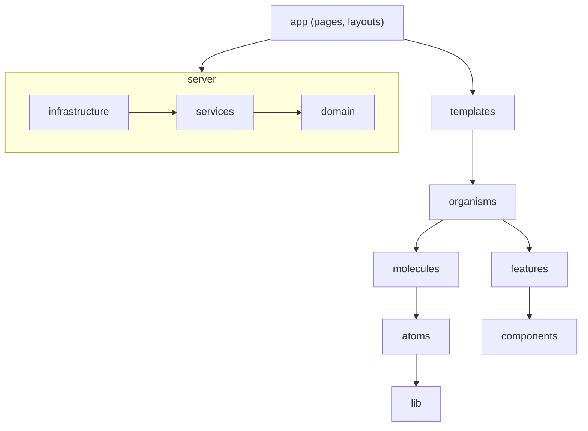

# Florian Palvadeau — Portfolio

[](https://github.com/FlorianPALVADEAU/Portfolio-2026-2027/actions/workflows/ci.yml)
[](https://github.com/FlorianPALVADEAU/Portfolio-2026-2027/actions/workflows/codeql.yml)

Portfolio of a full-stack software engineer, built to be fast, accessible and trilingual (French, English, German). The code is public on purpose: structure, tooling and history are part of the showcase.

> Status: foundations in place (M1). Design system, features and content follow on the [roadmap](https://github.com/FlorianPALVADEAU/Portfolio-2026-2027/milestones).

## Stack

| Area | Choice |
| --- | --- |
| Framework | Next.js (App Router, React 19, Turbopack), TypeScript strict |
| Styling | Tailwind CSS v4, shadcn/ui, design tokens, dark / light / Swiss themes |
| Motion and 3D | GSAP only, Lenis smooth scroll, React Three Fiber (lazy-loaded) |
| Server | Effect (schemas, services, layers), Resend, Cloudflare Turnstile |
| Content | Typed data validated at build, no MDX |
| Quality | Biome, dependency-cruiser, knip, Vitest, Playwright + axe, Storybook |
| Delivery | GitHub Actions, release-please, Lighthouse CI, Vercel |

## Architecture

Imports only point downward; the hierarchy is enforced by tooling, not convention.



- Pages and layouts are pure assemblies of templates and organisms (a Biome GritQL plugin rejects raw HTML there).
- Features are consumed through a public `index.ts` only.
- Effect lives in `src/server` and build-time content validation, never in client code.

Details: [`src/README.md`](src/README.md) and the [architecture decision records](docs/adr/README.md).

## Getting started

Requires Node 24 (see `.nvmrc`) and npm.

```bash
npm install
npm run dev
```

## Scripts

| Script | Purpose |
| --- | --- |
| `dev`, `build`, `start` | Run and build the app |
| `check`, `check:fix` | Biome lint, format and import sorting |
| `typecheck` | Route types and `tsc --noEmit` |
| `lint:arch` | Import hierarchy (dependency-cruiser) |
| `knip` | Dead code and unused dependencies |
| `test`, `test:coverage` | Vitest unit and component tests |
| `test:e2e` | Playwright end-to-end and accessibility tests |
| `storybook`, `build-storybook` | Component documentation |

## Workflow

Every change is an issue in a milestone, built on its own branch, reviewed through a pull request with passing checks and squash-merged with a Conventional Commit title. `main` is protected by a ruleset. See [CONTRIBUTING.md](CONTRIBUTING.md) and [AGENTS.md](AGENTS.md).
